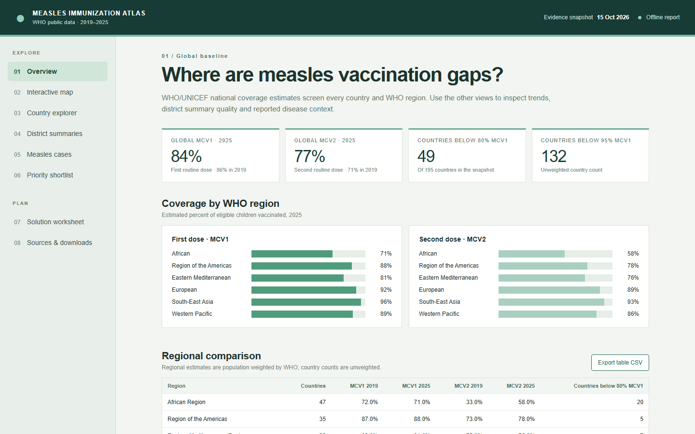

# Measles Immunization Atlas

An independent, source-backed exploration of routine measles vaccination gaps across **195 countries** and **six WHO regions**. The project combines 2019–2025 WHO/UNICEF coverage estimates, public country-level district summaries, and reported measles surveillance context in a locally generated, self-contained dashboard.

> **Independent project.** This repository is not affiliated with or endorsed by the World Health Organization. WHO data and third-party map assets retain their own terms; see [data provenance](docs/DATA.md) and [third-party notices](THIRD_PARTY_NOTICES.md).



**Start here:** Follow [Build the dashboard](#build-the-dashboard), then open the generated `dashboard.html` in a modern browser. The resulting dashboard works offline; no server or account is required. The public repository omits the bulk WHO extracts and generated HTML because WHO's [dataset terms](https://www.who.int/about/policies/publishing/data-policy/terms-and-conditions) govern redistribution and modifications.

## The problem

Measles protection depends on children receiving both scheduled vaccine doses. In the project's **2025 WHO/UNICEF snapshot**, global estimated coverage was **84% for MCV1** and **77% for MCV2**. Coverage varied substantially across regions and countries: **49 of 195 countries** had MCV1 below 80%. National averages can conceal communities that are not being reached. The central decision is where to investigate the vaccination gap more closely and which local barrier, if any, an immunization programme can address. These country counts are unweighted and do not measure the number of children missed. [WHO/UNICEF estimates methodology](https://www.who.int/news-room/questions-and-answers/item/who-unicef-estimates-of-national-immunization-coverage)

The [complete problem definition](reports/06_who_measles_problem_definition.md) describes the affected population, scope, evidence, measurement plan, questions to answer before ideation, and four candidate responses:

1. Make routine services easier and more reliable to use.
2. Find and follow up children overdue for a dose.
3. Assess a targeted catch-up or supplementary campaign.
4. Co-design access and communication with communities.

These are **options for local evaluation**, not recommendations for an unselected country. The [2025 global screen](reports/07_global_country_and_district_screen_2025.md) contains the detailed findings and quality audit.

## Explore the dashboard

| View | What it answers |
| --- | --- |
| Overview | How do global and WHO regional MCV1/MCV2 estimates compare in 2025? |
| Interactive map | Which countries have lower national coverage? Hover for national values, click for province/state outlines and country context. |
| Country explorer | How did coverage change from 2019 to 2025? Search, filter, and compare countries or regions. |
| District summaries | Which public country-level district-band values are present and internally consistent? |
| Measles cases | What cases and incidence were reported? Surveillance is shown separately from coverage. |
| Priority shortlist | Which countries match visible screening criteria for deeper investigation? |
| Solution worksheet | What local evidence, owner, test, and outcome would be needed for one of the four options? |
| Sources & downloads | Where do the values come from, and how can the displayed tables be exported? |

**Map boundary:** Province/state shapes provide geographic orientation only. The public WHO extract does not identify individual areas or provide their coverage values. Named-area analysis awaits a validated [WHO detailed subnational extract](https://immunizationdata.who.int/docs/librariesprovider21/additional-datasets/how-to-access-more-data.pdf?sfvrsn=ee878941_1) or national programme data. See [map resources and join plan](reports/08_interactive_map_resources.md).

## Build the dashboard

Requirements: Python **3.11+**, internet access for the initial WHO downloads, and `requests`. Clone the repository, then run from its root:

```powershell
python -m pip install -r requirements.txt
python scripts/download_who_mcv1.py
python scripts/download_who_mcv1.py --indicator MCV2
python scripts/download_who_system_performance.py
python scripts/download_who_measles_cases.py
python scripts/build_global_screen.py
python scripts/build_dashboard.py
python scripts/validate_snapshot.py
```

The generated `dashboard.html` embeds the downloaded data, CSS, JavaScript, and map geometry. WHO may revise its figures; the validator checks the **15 October 2026 reference snapshot** and may need its expected counts updated after a new download. The [CI workflow](.github/workflows/validate.yml) checks the public source package without depending on a mutable WHO API response.

### Refresh geography

The simplified Natural Earth boundaries are included. To regenerate them, install Node.js/npm and run:

```powershell
python scripts/prepare_map_geometry.py
```

This downloads the source geometry and uses Mapshaper through `npx`. Review boundary changes before replacing the packaged geometry.

## Repository layout

```text
app/                  Dashboard source and vendored Leaflet assets
data/raw/             WHO extracts and lookups generated locally
data/processed/       Country and regional screens generated locally
data/geo/             Simplified Natural Earth boundaries
docs/                 Data provenance and dashboard image
reports/              Problem definition, analysis, and map resource review
scripts/              Download, processing, validation, and build scripts
dashboard.html        Self-contained offline dashboard generated locally
```

## Interpretation and responsible use

- MCV1 and MCV2 can target different ages and populations. Their percentages **cannot be subtracted to infer individual dropout**.
- Public district-band summaries are country-level administrative reports. A consistency flag checks arithmetic, not denominator quality or completeness.
- A blank measles case value is missing, while a published zero is zero. Case reporting depends on surveillance and should not be read as an effect of a specific coverage value.
- The shortlist is an exploratory country screen. It does not estimate missed-child counts, rank named districts, or forecast outbreaks.
- Country and province/state boundaries are Natural Earth reference geometry and may differ from WHO or national boundary conventions.

Read [data provenance and definitions](docs/DATA.md) before reusing results. WHO's [dataset terms](https://www.who.int/about/policies/publishing/data-policy/terms-and-conditions) govern its data and require attribution; the [MIT license](LICENSE) applies only to this project's original code and documentation. The project uses no WHO emblem or claim of WHO endorsement.
